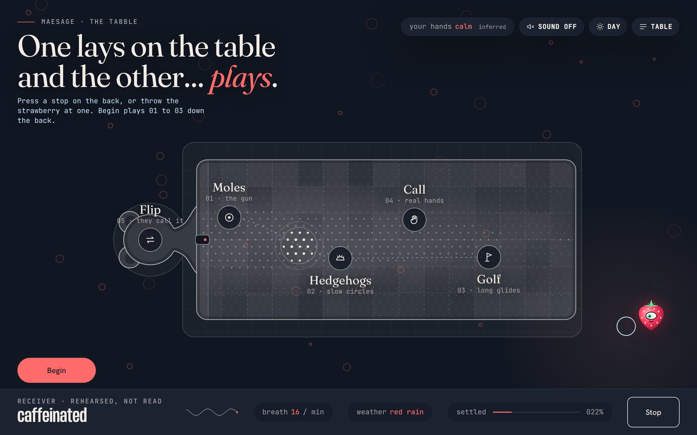
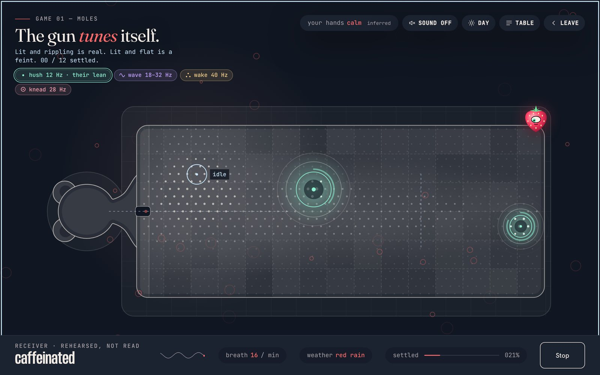
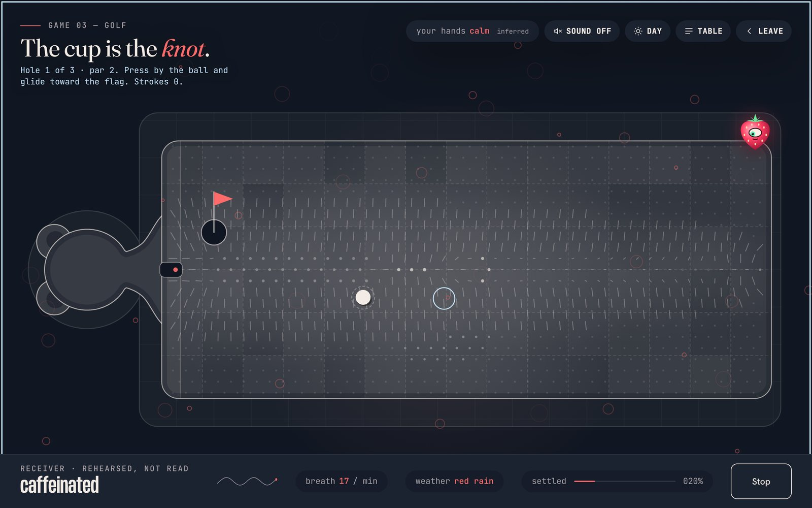
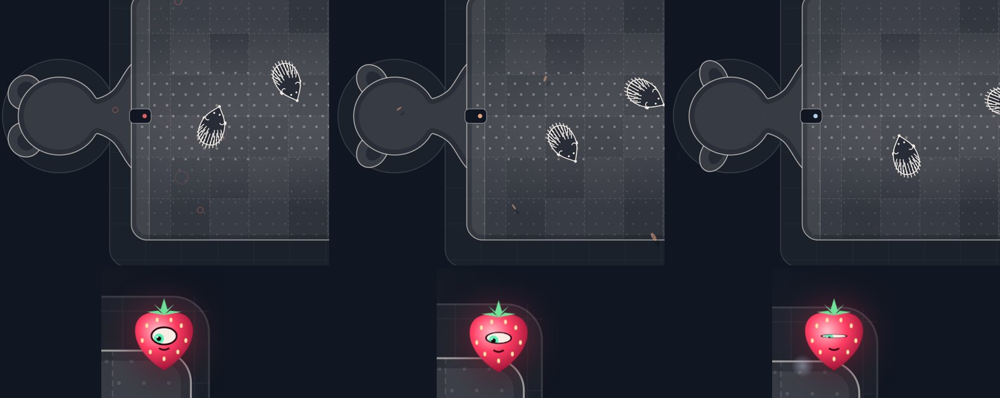

# Maesage

One lays on the table and the other… plays.

Maesage is a haptic suit and a partner touch game. The suit lights a spot and hums under it; the player answers with hands or a massage gun; the gun tunes itself by hovering. This repo holds the playable browser studies, the server that links two screens, and the plans.



| Moles: hover a lit spot and the gun tunes itself | Golf: the cells lie along the slope |
|---|---|
|  |  |

No body is drawn. The receiver is tucked in under a quilt of haptic cells, and the quilt is the board the games are played on. The hood's ears and the strawberry's eye both follow the receiver, from braced to puddle:



## Play it

```
go run ./cmd/tabble
```

Open `http://<this machine>:8787` on two screens on the same network. On the phone that goes under the face cradle, choose **On the table**. On the other screen, choose **05 Flip**. The person on the table picks a setting and touches where they want it; the spot lights on the player's screen. Stop and the ceiling belong to the table's screen.

A third screen can watch: open `http://<this machine>:8787/#watch` on a TV. It follows whoever is playing and shows the receiver's state large. `#table` opens straight onto the table's screen.

A fourth screen can read the receiver: on a spare phone open `https://<this machine>:8788/#sense`, accept the certificate warning once, press **Start feeling**, and lay the phone on their lower back, screen up. Ten seconds later every screen shows their real breath rate, and the state, the weather and the settle figure follow it. It has to be the https address: browsers do not give a page its motion sensor over plain http.

One screen works too: stops 01 to 04 need nothing else.

| Stop | Game | Teaches | How |
|---|---|---|---|
| 01 | Moles | percussion | Hover a lit spot and the gun tunes itself. Hold to percuss. |
| 02 | Hedgehogs | kneading | Knots with legs. Slow circles curl one up. Rush and it bristles. |
| 03 | Golf | long glides | One glide a stroke. The cup is the knot. |
| 04 | Call | real hands | No suit, no gun. The screen calls a spot and a technique every 20 s. |
| 05 | Flip | listening | The one on the table places the spots. You answer. |

## Rules the games keep

- Colour is the setting: hush 12 Hz, wave 18–32 Hz, wake 40 Hz, knead 28 Hz. Each has a glyph too.
- Lit and rippling is real. Lit and flat is a feint on the player. Rippling with no light is the suit teasing the receiver.
- The gun cuts out over the spine, neck, head and the backs of the knees.
- The receiver's ceiling caps the gun. Stop is latched, and a stop from the table's screen is lifted only there.
- State is inferred and labelled inferred. With a phone on their back it is read from breath and says so, with how sure it is. With nothing reading them it is a rehearsal, and where even that makes no sense the page says there is no reading.
- The state is also the weather over the back: red rain when braced, peach fall, mint clearing, night garden when they are a puddle. The accent follows it and a chip names it.

## Layout

| Path | What |
|---|---|
| `web/index.html` | The whole game: one page, built on Depthfield. Also published as a private claude.ai artifact, where it uses the platform's room instead of this server. |
| `web/vendor/depthfield-2.3.0/` | Depthfield's `tokens.css`, `bundle.css` and `bundle.js`, copied unchanged from `stevoblevo/depthfield` at 2.3.0. Pinned by copy until the kit publishes versioned builds (family task F2). |
| `cmd/tabble` | Go. Serves the page over http and https, relays presence between screens over one event stream, and takes a phone's accelerometer. Standard library only. |
| `internal/breath` | Go. Turns that accelerometer stream into a breath rate, how sure it is, and a settle figure. |
| `docs/` | Design notes: the games, the suit's oil, cooling and power. |

## Style

The page is built on Depthfield, the night half of the toolkit family: its tokens and themes, its Tool, Drawer, Button, Tag, HudChip, Slider and Toggle, its lamp, stretch type, sense, tone and guardian. The page's own stylesheet is layout only.

- One scene. Each game sits once, on the part of the body it works. Settings live in a sheet ("Table").
- The receiver's state word is the page's one stretch line: its width is how settled they are.
- The lamp follows the hand and the room light dims what only reflects. Lit spots keep their own light.
- The strawberry guardian reviews in one dry line and can be thrown at a stop to start it. Its eye closes as the receiver settles.
- No body is drawn: no skin, no anatomy, no outline. A hood shows above a quilt, and the cloth is lighter where the person lifts it. The hood has ears, up when the receiver is braced and flopped when they are a puddle.
- A rehearsed state says "rehearsed", a guess says "inferred", a reading says what it read.

Check a change with Taste before anyone reviews it: open the page with `?df-taste`, at desktop and phone width, in night, day and high contrast. It is clean today.

## Languages

Server and tooling code is Go, Rust or Erlang. The page is JavaScript because that is what a browser runs; nothing else here is Node or Python.

## Check it

```
go vet ./... && go test ./...
```

The tests cover the room (presence travels between screens, a leaving screen is forgotten, bad presence is refused), the certificate, and the breath estimator against a synthetic phone: rates from 6 to 24 a minute, an empty table, a massage gun running, a breath that slows.

Not yet checked on a person. The games were play-tested in a headless browser, and the breath reading has only ever seen signals a test made up. A real back, a real phone and real hands are issue #1 and issue #4.

## Where plans live

Issues. One issue per decision or build step; comment there. To change something, read [CONTRIBUTING.md](CONTRIBUTING.md) first; it is short.

## Licence

Apache License 2.0, in [LICENSE](LICENSE). Use it, change it, ship it; keep the licence and say what you changed. Contributions are taken under the same licence, and it carries a patent grant from each contributor for what they contribute.

One part is not covered: `web/vendor/depthfield-2.3.0/` is a copy of [Depthfield](https://github.com/stevoblevo/depthfield), a separate kit by the same author, and it stays under that project's own terms.
